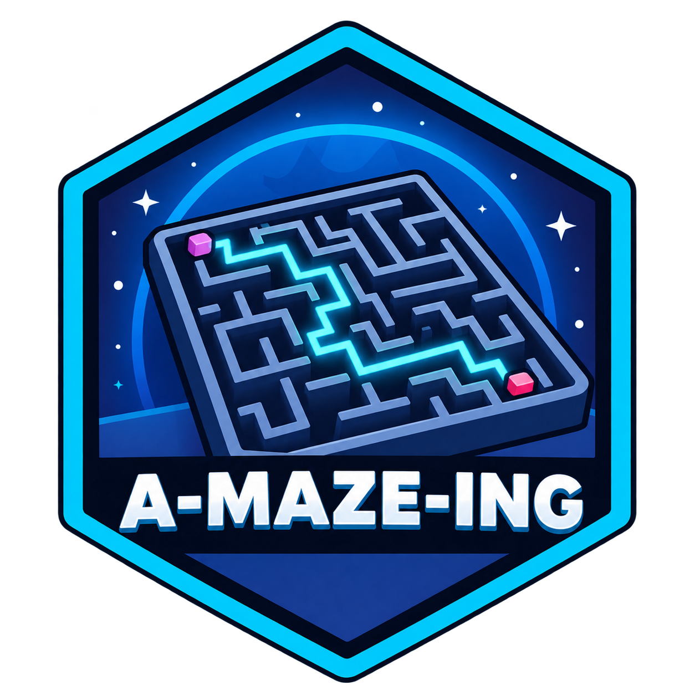
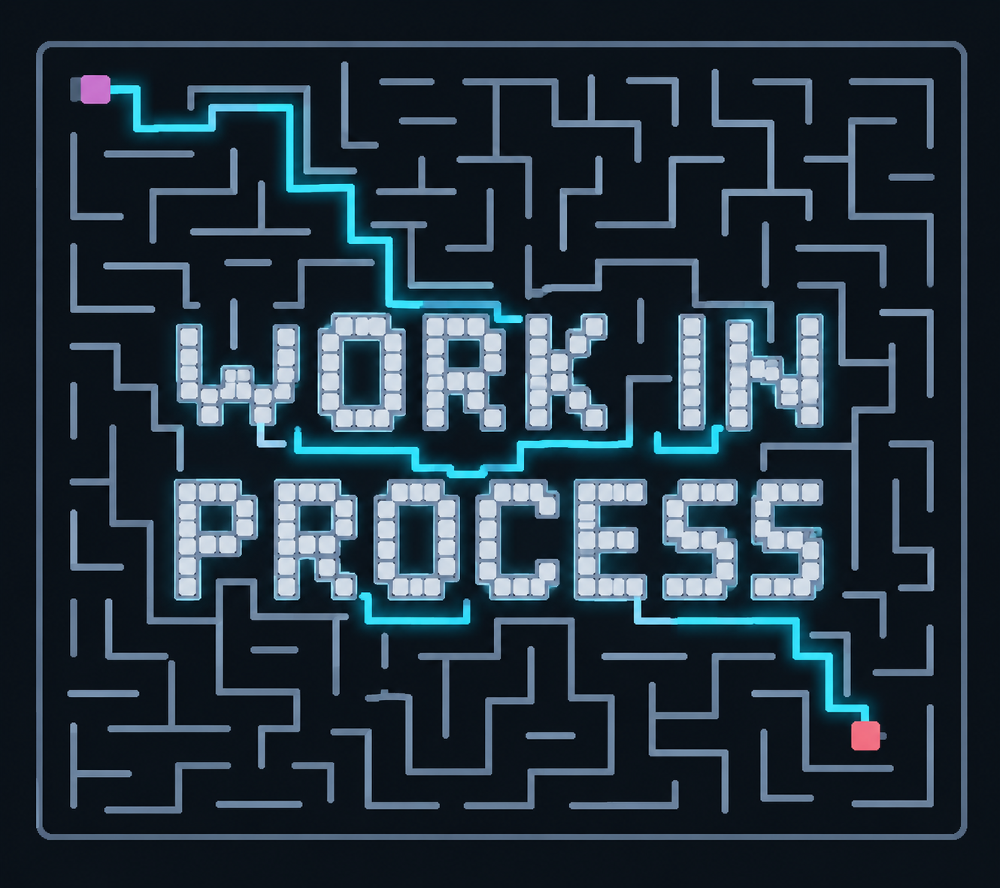

*This project has been created as part of the 42 curriculum by iualkhim and ...*

  

## Description

The main goal of the `A-Maze-ing` project is to develop a program that generates mazes based on a configurable set of parameters, with the ability to visualize the maze structure and explore its paths.

This project is an exercise in **graph theory**, **pathfinding algorithms**, **data parsing**, and **Python programming**. It also provides an opportunity to explore **visualization techniques** and modular software design while working with maze generation and solving.

  

### Authors and Contributions

This project was developed in pairs as required by the 42 curriculum:

- **Julia Alkhimova (iualkhim)**:
- **...**:

## Instructions
To be completed.

## Resources
To be completed.

---
**AI Usage:**
To be completed.
